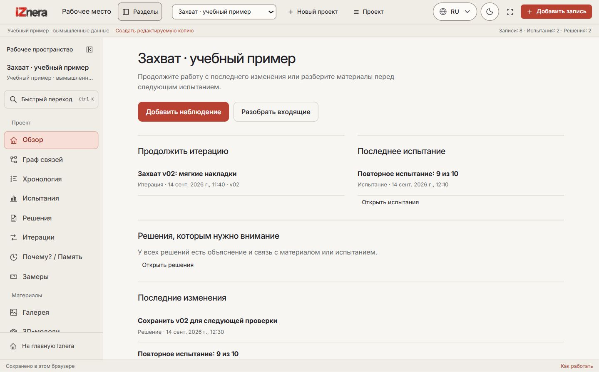
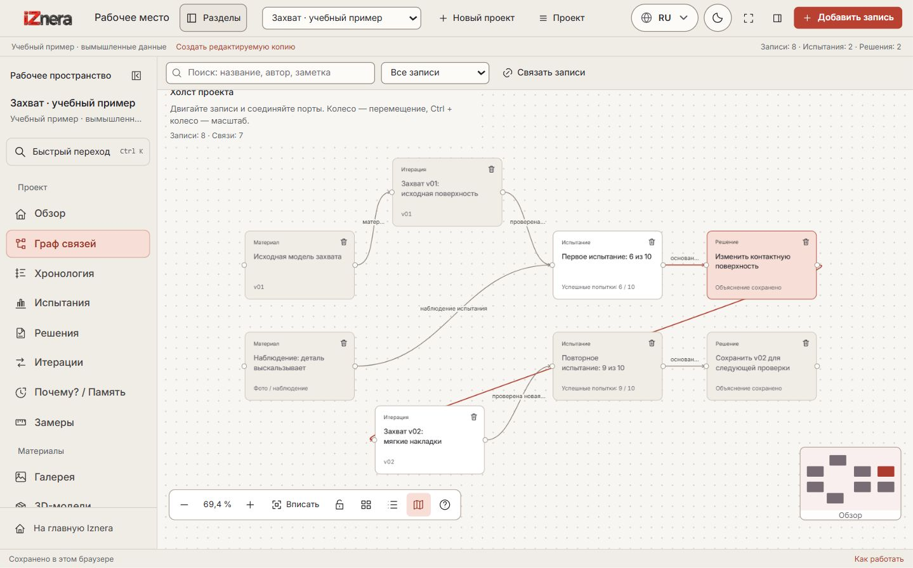
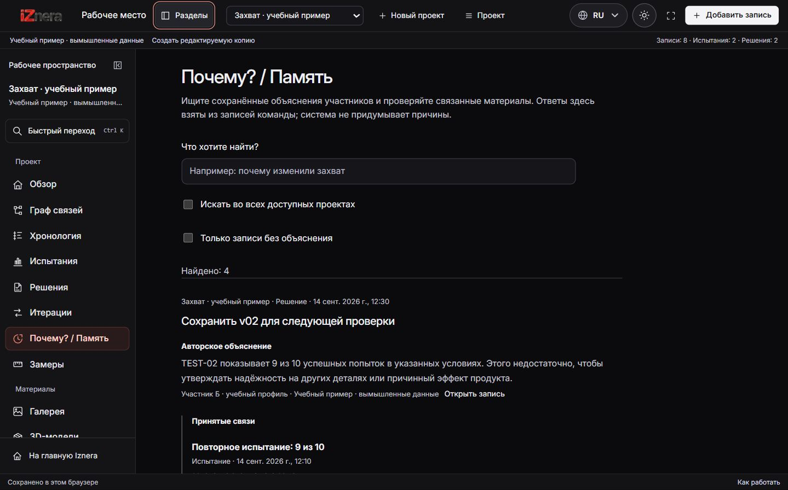
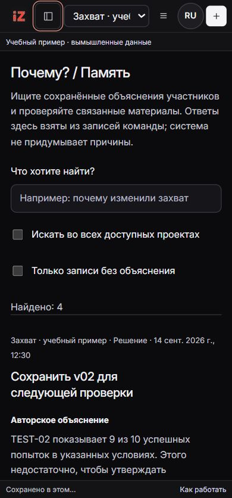
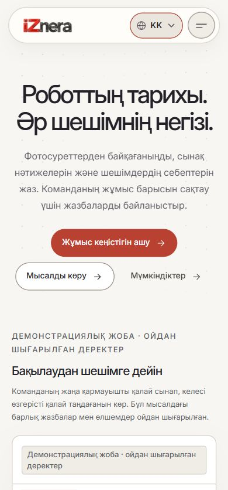

# Iznera: результаты проверки 1 ноября 2026

Проверяется текущая ветка `codex/unified-team-pilot`, активная статическая оболочка `website/tracelab` и root Next/API. Пользовательские проекты не использовались для разрушительных сценариев. Все записи, загрузки, миграции тестовой схемы и проверки удаления выполняются на отдельных вымышленных fixtures. Просмотр миниатюр настоящей команды был только чтением; её изображения не входят в evidence ниже.

## Выполненные проверки

| Проверка | Результат и граница |
| --- | --- |
| `npm run test:static` | **188 passed**, без пропусков. Навигация, локализация, темы, store/queue, итерации, timeline, Inbox, handoff и report helpers. |
| `npm run test` | **160 passed, 93 skipped** в обычном запуске. DB suites требуют явной отдельной базы; они проверены следующим запуском. |
| `node scripts/test-isolated-db.mjs` | **15/15 suites, 93/93 tests passed**, без пропусков, после подключения API и storage fence. Новая БД `tracelab_unified_test_1793537646773_5ec931a7`; существующая рабочая база не использовалась для destructive fixtures. |
| Исключение из disposable runner | Старый `tests/tenancy.db.test.ts` ожидает legacy seeded demo и явно исключён. Lifecycle включён в общий runner через зарегистрированную 0015 и `account-lifecycle.db.test.ts`; временные candidate SQL/runner удалены после интеграции. Текущие реальные RLS/foreign-team/author/revoke границы проверяются самостоятельными suites. |
| `npm run typecheck`, `npm run lint` | **Passed** на окончательной интегрированной реализации, включая lifecycle API и интерфейс. |
| `npm run build` | **Passed**, включая Proxy CSP. Сборка сама по себе не означает production-конфигурацию или внешнюю доставку писем. |
| CSP | Два unit-теста входят в общий passed count; настоящие HTTP 200 static/auth имеют hash/nonce и не имеют `unsafe-inline` в `script-src`. React-форма гидратируется, тема переключается, ошибок CSP нет. [Границы политики](DOCUMENT_CSP.md). |
| Production Origin и pilot preflight | **4/4 HTTP checks + 9/9 preflight tests passed**. Отдельный localhost production server отклоняет foreign/missing Origin и чужой target Host. Пустая форма не создаёт аккаунты и не отправляет письма; внешняя доставка отключена. |
| Lifecycle | **11 DB cases** входят в 93; **8 HTTP boundary tests** входят в 160. Проверены 7-дневная отмена, последний руководитель и concurrent requests, exact-key file cleanup, NULL/stale ACK, retry/lease, поздний PUT и сбой completion journal. Незавершённый PUT блокирует purge. Дополнительный scoped auth/lifecycle прогон **18/18 passed** после hooks. Настоящие команды/аккаунты не удалялись. |
| Combined DB + files recovery | **Passed** в новых source/restored базах. Фото, thumbnail и immutable JSON report восстановлены с совпадающими SHA-256, подписью/автором; чужому пользователю отказано. [Воспроизводимая проверка](RECOVERY_REHEARSAL.md). |
| Глобальный `npm run i18n:audit` | **Failed: 277 кандидатов для проверки** в TSX. Большинство — старые перенаправленные `/app` и их компоненты; есть brand/native-language/unit false positives. Скрипт не охватывает статические JS-словари, поэтому ни процент покрытия, ни полная готовность локализации не заявляются. |

## Проверка в браузере

Движок — встроенный Chromium-браузер Codex. Измерены **CSS innerWidth**, а не только физические настройки: 358, 374, 390, 767, 1024 и 1438 px. Для 320 px встроенный браузер ограничил минимальную ширину; этот размер **не подтверждён**. 374/767/1438 — ближайшие фактически полученные значения к 375/768/1440.

- Тёмная и молочная темы проверены в рабочей области, публичной странице и форме аккаунта. Молочная форма имеет тёмный текст на светлом поле. Меню телефона содержит переключатель темы.
- На 940 px переключатель темы виден в footer боковой панели; скрытый в шапке control не оставляет пользователя без выбора. После проверки viewport возвращён к обычному размеру.
- RU/EN/KK оболочка переключается; авторские названия сохраняются. Проверены длинные казахские пункты и fallback названий месяцев для встроенного ICU.
- Исправлен реальный hydration mismatch дат в KK-аккаунте: даты/сроки имеют детерминированный UTC формат с казахскими названиями месяцев. После reload новых ошибок hydration нет.
- Sidebar сворачивается; мобильная панель закрывается после выбора раздела. Видимые страницы не имеют общего горизонтального переполнения на проверенных ширинах.
- Быстрый переход ищет разделы и записи; Enter открывает результат, Escape закрывает окно и возвращает фокус. Редактор readonly-итерации начинает с заголовка и `scrollTop=0`.
- В «Решениях» учебного проекта по умолчанию две записи типа decision; полный журнал доступен явно. Memory показывает сохранённые причины/принятые связи и честные пробелы.
- Обзор показывает текущую итерацию рядом с последним испытанием на широком экране и одной колонкой на 390 px; основные действия выделены, переполнения нет. Это обзор последних записей проекта, а не недельная аналитика.
- Timeline группирует по итерациям, сохраняет фильтр в URL и восстанавливает его при Back/Forward. В настоящей команде две видимые приватные миниатюры загрузились; данных не меняли.
- «Вписать граф» оставляет верхние карточки ниже подсказки. Для графа есть управление масштабом, клавиатура, список и мини-карта.
- Компоновщик отчёта проверен чтением: выбор формата, состава и порядка, предупреждения, подтверждение разрешений и блокировка конкурсного режима без проверенной policy. Файл настоящей команды не создавался.
- В аккаунте загружен статус lifecycle и dry-run состава настоящей команды. Пароль не вводился, запрос удаления не создавался. Последний руководитель видит блокировку закрытия аккаунта.

## Не подтверждено этим прогоном

- Полная последовательность auth → offline phone reload → reconnect → live email на физических телефонах; реальные touch gestures, screen reader и zoom 200%.
- Проверка казахского носителем языка, Lighthouse/полевые performance-метрики, реальный пилот и достижения на соревнованиях.
- Resend/DNS, Supabase private storage, HTTPS/public domain, внешние GitHub deliveries, TURN между разными сетями, production scheduler и backup retention.
- Очистка локальных synthetic DB/files включена в lifecycle tests. Автоматическая очистка резервных копий провайдера, production scheduler и эксплуатационная проверка unresolved writers **не подтверждены**. Account closure сохраняет командные инженерные объяснения/готовые отчёты с техническим авторским следом; это не обещание стирания всех копий и упоминаний. [Точное поведение и операторские действия](ACCOUNT_LIFECYCLE.md).

Точные внешние переменные и пошаговая настройка: [Pilot launch](PILOT_LAUNCH.md), [Resend](account-mail-setup.md), [Storage и другие сервисы](EXTERNAL_SERVICES.md). [Руководство пользователя](IZNERA_USER_GUIDE_RU.md) содержит путь от наблюдения до отчёта. [Матрица всех десяти документов](plan-traceability.md) сохраняет частичные, внешние и отложенные требования.
